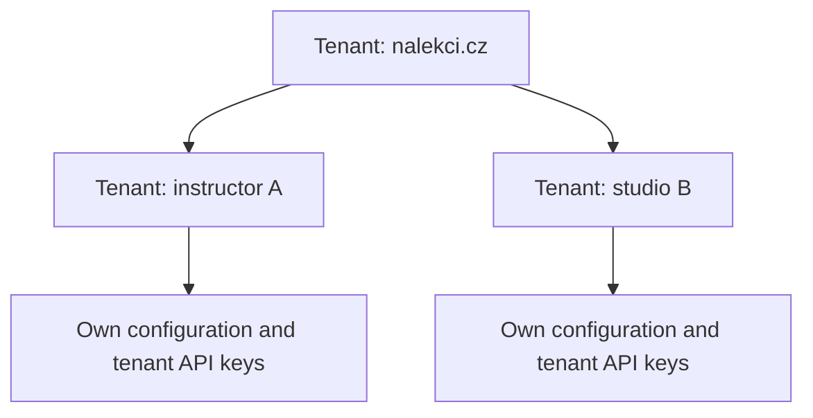

# Feature 1: tenants, subtenants, and API access

## Goal

Create the first tenant, `nalekci.cz`, and let its backend create and manage tenants for individual instructors and studios through an API.

Every subtenant receives its own API key and can read and update its own configuration, including a contact email. One subtenant must never be able to read or change another subtenant's data.

This feature uses ASP.NET Core and a local PostgreSQL database running in Docker. It does not require Neon, Resend, bank connections, QR generation, or payment processing.

Human login, browser sessions, and key management by signed-in users are specified separately in [Feature 002](./002-user-login-and-sessions.md). Feature 001 works without them: the backend generates initial keys during administrative setup and child keys during subtenant creation.

This document is the implementation scope for Feature 1. Where older specifications describe a separate Account entity or require more functionality, this document takes precedence. The shared tenant model is intended to support bank accounts, QR codes, and payment matching later for both root tenants and subtenants.

## 1. One tenant model

A tenant is an independent owner of configuration and, later, payment data. A subtenant is the same entity with a parent tenant assigned.



- Root tenants have no parent. Subtenants have one parent.
- Both use the same configuration endpoints and, in later features, the same payment functions.
- A parent may also receive payments itself later; it is not just a container for its children.
- Each tenant owns its own data. A bank account or payment will belong to a specific tenant, rather than implicitly to the whole hierarchy.
- Feature 1 supports one level of subtenants. Creating grandchildren and moving a tenant to a different parent are outside this feature.
- There is no separate Account or Merchant entity for instructors and studios.

## 2. Tenant configuration

| Field | Meaning | Who can change it |
| --- | --- | --- |
| `id` | Stable tenant identifier. | Assigned by Pairrot; immutable. |
| `parent_tenant_id` | Parent identifier; empty for root tenants. | Assigned when created; immutable. |
| `external_id` | Instructor or studio identifier supplied by NaLekci. Unique within its parent. | Parent supplies it on creation; immutable in Feature 1. |
| `name` | Display name, such as an instructor or studio name. | Tenant itself or its parent through management access. |
| `contact_email` | Contact address supplied by the tenant or NaLekci. | Tenant itself or its parent through management access. |
| `status` | `active`, `suspended`, or `deleted`. | Parent may suspend or reactivate a child; deletion uses a separate operation. Root status is managed administratively. |
| `can_create_subtenants` | Allows use of subtenant management functions with a management key. | Administrative configuration only. |
| `can_create_campaigns` | Reserved for future campaign creation. Remains `false` for all tenants in Feature 1. | Not editable through the API. |
| `created_at`, `updated_at`, `deleted_at` | Record creation, changes, and deletion. | Maintained by Pairrot. |

The contact email is optional at creation: NaLekci can create a child, hand over its key, and let the child supply an email through its configuration endpoint. When supplied, validate its format, but do not send or verify emails in this feature. Different tenants may share a contact email; it is not a login or unique identifier. An unset email is returned as `null` and does not block the configuration API.

Capabilities are explicit permissions, not inherited from the parent. They default to `false`. Changing a name or email must not allow a caller to change capabilities, status, or ownership through extra request fields; unsupported fields are rejected.

### Initial configuration

| Tenant | Can create subtenants | Can create campaigns |
| --- | --- | --- |
| `nalekci.cz` | `true` | `false` |
| New instructor or studio | `false` | `false` |

Campaign permission is stored for future use and remains `false`, including for `nalekci.cz`. Campaigns and campaign endpoints are outside Feature 1.

## 3. API keys and access boundaries

There are two key purposes:

| Key | What it can do |
| --- | --- |
| Tenant key | Read the owning tenant and read or update its name and contact email. Future payment operations will use this same tenant scope. |
| Management key | List, create, read, update, suspend, delete, and manage keys for the owning tenant's direct children, provided `can_create_subtenants` is enabled. |

NaLekci receives a management key for its instructors and studios, and a separate tenant key for its own configuration. Every newly created subtenant receives a tenant key. Subtenants do not receive management keys in Feature 1.

Rules:

- Send keys using `Authorization: Bearer <key>` over the API.
- The key determines the caller's tenant and purpose. A request body, header, or query parameter cannot override that identity.
- A tenant key cannot use management endpoints, even if its owner has `can_create_subtenants` enabled.
- Management permission requires both the correct key purpose and the current capability setting. Disabling the capability takes effect on the next request.
- A management key works only with direct children of its owner. Knowing another tenant's identifier grants no access.
- A management key does not act as a tenant key on configuration endpoints. It uses the explicit child management endpoints to manage child configuration.
- NaLekci is a trusted administrator of its children and can issue new child keys. Isolation is between unrelated tenants and between siblings; it is not isolation from the authorized parent administrator.
- Invalid, revoked, or deleted-tenant keys are rejected. Suspended tenants cannot use their keys. A child also cannot use its keys while its parent is suspended or deleted.
- Every administrative change is attributed to the key that performed it.

### Key lifecycle

- Generate random, unguessable secrets. Return the full key only when it is created.
- Store a verifier of the secret, not the full key. Do not include secrets in logs, list responses, or change history.
- Multiple tenant keys may coexist so callers can introduce a new key before revoking an old one.
- NaLekci can list key metadata, issue a new tenant key, and revoke an individual tenant key for its children. These operations cannot issue management keys.
- If a creation response is lost, NaLekci finds the child by `external_id` and issues a replacement key. The original secret cannot be retrieved.
- Suspension blocks use of existing keys without revoking them; reactivation restores access unless a key was separately revoked.
- Deleting a child revokes all of its keys. Root key creation and rotation are administrative operations for this feature.

## 4. API contract

All paths below use the `/v1` prefix. Responses use JSON. List endpoints are paginated. IDs are opaque identifiers; clients should not derive ownership from their format.

### Current tenant

These endpoints require a tenant key and always address its owner. They accept no target tenant identifier.

| Method and path | Behavior |
| --- | --- |
| `GET /v1/tenant` | Return the caller's tenant identity, status, parent identifier, and capabilities. |
| `GET /v1/tenant/configuration` | Return the caller's `name` and `contact_email`. |
| `PATCH /v1/tenant/configuration` | Update the supplied `name` and/or `contact_email`; return the resulting configuration. |

### Manage direct subtenants

These endpoints require a management key and `can_create_subtenants = true` on its active owner.

| Method and path | Behavior |
| --- | --- |
| `POST /v1/subtenants` | Create an active direct child with `external_id`, `name`, and optional `contact_email`. Return its details and its first tenant key once. |
| `GET /v1/subtenants` | List the owner's direct children. Support exact `external_id` and `status` filters. Exclude deleted children by default. |
| `GET /v1/subtenants/{id}` | Return a direct child's details and configuration. Never return key secrets. |
| `PATCH /v1/subtenants/{id}` | Update `name`, `contact_email`, or status between `active` and `suspended`. Capabilities and ownership cannot be changed. |
| `DELETE /v1/subtenants/{id}` | Mark a direct child as deleted and revoke its keys. Repeating deletion has no additional effect. |
| `GET /v1/subtenants/{id}/api-keys` | List that child's key identifiers, labels, purpose, creation time, and revocation time. |
| `POST /v1/subtenants/{id}/api-keys` | Issue a tenant key with an optional label and return its secret once. Allowed for active or suspended children. |
| `DELETE /v1/subtenants/{id}/api-keys/{keyId}` | Revoke the specified child key. Repeating revocation has no additional effect. |

Deleted children remain readable through their parent's management endpoints for history, but cannot be edited, reactivated, or issued new keys. Their `external_id` remains reserved. An explicit deleted-status filter may include them in the list.

### Example: creating a studio

```http
POST /v1/subtenants
Authorization: Bearer <nalekci-management-key>
Content-Type: application/json

{
  "external_id": "studio_123",
  "name": "Studio Balance",
  "contact_email": "studio@example.com"
}
```

The response contains a `tenant` object with its assigned ID, parent, configuration, status, and capabilities, plus an `api_key` object with its identifier and one-time secret. The child then uses that secret to call `/v1/tenant/configuration`.

Creating a child with an already used `external_id` under the same parent returns `409 Conflict`; it never creates another child or another key. The same external identifier under a different parent is allowed. Creating the child and its initial key succeeds or fails as one database operation.

### Error behavior

| Status | Meaning |
| --- | --- |
| `400` | Invalid input, unsupported fields, malformed email, or missing required fields. |
| `401` | Missing, invalid, or revoked key, including a key belonging to a deleted tenant. |
| `403` | Valid key with the wrong purpose, missing capability, or a suspended owner or parent. |
| `404` | Resource does not exist within the caller's permitted scope. Use the same response for a foreign resource and an unknown identifier. |
| `409` | Duplicate external identifier or an operation incompatible with the target's state. |

Successful creation returns `201`, reads and updates return `200`, and deletion or key revocation returns `204`. Error responses include a stable error code and a readable message, without foreign tenant details or secrets.

## 5. Database schema

The companion [SQL schema](./001-tenants-schema.sql) defines three tables:

| Table | Stores |
| --- | --- |
| `tenants` | Root tenants and subtenants, their configuration, capabilities, and lifecycle state. |
| `tenant_api_keys` | Key ownership, purpose, secret verifier, and revocation state. |
| `tenant_audit_events` | Who created or changed tenants and keys, when, and which tenant was affected. |

The parent relationship and the unique `(parent_tenant_id, external_id)` constraint protect identity. API authorization must additionally enforce the hierarchy: database foreign keys alone do not prevent a request from reading another tenant's records.

Use logical deletion. Tenant deletion and key revocation happen together. Configuration changes and their audit records are also saved together. Audit records include changed fields where useful, but never full API keys or secret verifiers.

The schema intentionally contains no separate subtenant table, users, bank accounts, campaigns, or payment tables. IDs and timestamps are assigned by the application, and timestamps are stored with a time zone. The application maintains `updated_at` when data changes.

## 6. Local setup

- Run PostgreSQL locally through Docker Compose, with a persistent volume for development data.
- Run ASP.NET Core locally against that database. The later production target remains VPS + Docker Compose with Neon PostgreSQL.
- Provide a repeatable administrative setup command that creates `nalekci.cz`, sets `can_create_subtenants = true` and `can_create_campaigns = false`, and issues its initial tenant and management keys.
- Allow the root contact email to be supplied during setup or later through the configuration API; do not invent a production address or commit real credentials.
- Repeating setup must not create another root tenant, silently change existing configuration, or replace keys. Fresh secrets are shown only when first issued.
- A separate explicit administrative action may issue replacement root keys or revoke old ones. It is not an anonymous HTTP endpoint.
- The local Vite + React SPA may be used to test this API. For Feature 1, its scope is tenant configuration, child CRUD, and key lifecycle. It is never deployed to production.

No background task is needed to complete tenant CRUD. `BackgroundService` remains part of the broader architecture for later email and payment processing.

## 7. Acceptance criteria

1. A fresh local setup produces one active `nalekci.cz` tenant with `can_create_subtenants = true`, `can_create_campaigns = false`, and usable tenant and management keys. New children also have `can_create_campaigns = false`. Repeating setup preserves the existing tenant and keys.
2. NaLekci's management key creates an instructor and a studio, lists them, reads their configuration, and updates their names and emails.
3. Each child receives a different key, and its current-tenant endpoints return only its own identity and configuration.
4. An instructor cannot read or modify a sibling, parent, unrelated tenant, or their keys. Attempts do not disclose whether a foreign resource exists.
5. Tenant keys cannot call management endpoints. A management key whose owner lacks the required capability cannot create or manage children.
6. Requests cannot grant capabilities, change parent ownership, create grandchildren, or choose a different caller tenant.
7. A child can be created without an email and then set it using its own key. Invalid supplied emails and empty names are rejected. Unrelated tenants may use the same email without being merged.
8. Concurrent creation with the same parent and `external_id` produces one child and one initial key; the other request receives a conflict.
9. A newly issued child key works, both keys can coexist, and a revoked key stops working immediately. Listing keys never reveals their secrets.
10. Suspension blocks the child's access. The parent can still inspect and reactivate it; separately revoked keys remain revoked. Suspending the parent also blocks child access.
11. Deleting a child blocks its keys and preserves its history. Repeated deletion is safe, and the deleted child cannot be reactivated or recreated under the same external identifier.
12. Changes record their actor and target without exposing secrets. Database contents and application logs contain no usable full API keys.
13. Tenant data and key validity survive application and database container restarts when the local database volume is retained.
14. The complete feature can be exercised locally without Neon, Resend, email delivery, bank access, QR generation, or payment processing.

## 8. Not included

- Bank account configuration, QR codes, payments, matching, inbound email, and outgoing payment webhooks.
- Campaign CRUD; only the permission setting is introduced now.
- Public tenant registration, user accounts, password login, invitations, and email verification.
- More than one level of subtenants, moving children, and automatic inheritance of permissions.
- Billing, pricing, and production frontend deployment.

These remain separate features. Feature 1 establishes who owns data, who can manage whom, and how callers authenticate.
