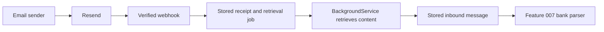

# Feature 006: inbound email reception through Resend

## Goal and scope

Receive an actual email sent to a tenant's bank-notification address, store its source content, and make it available for later bank parsing. Replace the test-only address provider with a real Resend integration while retaining a local stub for development.

This feature handles reception and retrieval. [Feature 007](./007-bank-message-parsing.md) interprets bank content and creates transactions. Receiving an email must never directly mark an [expected payment](./005-expected-payments.md) as paid.

The backend remains one ASP.NET Core application with a `BackgroundService`. PostgreSQL runs locally in Docker during development, and the SPA stays local. A real provider test needs an accessible HTTPS webhook endpoint; Neon and a production frontend are not prerequisites.

## 1. Provider contract verified for this design

Resend supports receiving at its managed subdomain or a configured custom receiving domain. A receiving domain accepts addresses under it, so Pairrot can allocate opaque local parts and keep its own routing map; a new provider mailbox is not required for every tenant. [Resend receiving documentation](https://resend.com/docs/dashboard/receiving/introduction).

The `email.received` webhook contains metadata. Body text, HTML, and headers are retrieved separately from the Receiving API. Do not expect the webhook to contain a complete bank email. [Resend email content](https://resend.com/docs/dashboard/receiving/get-email-content).

Verify the original request body with the endpoint's signing secret and the `svix-id`, `svix-timestamp`, and `svix-signature` headers, using a supported verifier and its timestamp checks. Parsing and reserializing JSON before verification can invalidate the signature. [Resend webhook verification](https://resend.com/docs/webhooks/verify-webhooks-requests).

The Receiving API exposes provider-computed authentication results as well as message content. Persist those results separately from sender-supplied headers. A valid webhook establishes delivery by Resend; it does not establish that the email originated at a bank. [Retrieve received email](https://resend.com/docs/api-reference/emails/retrieve-received-email).

The policies, tables, state names, limits, and API paths below are Pairrot design decisions.

## 2. Live addresses and existing stub addresses

Introduce `inbound_addresses` as the durable address-to-bank-connection map. Each record has an immutable address, tenant, bank connection, provider instance, mode (`stub` or `resend`), lifecycle state (`active` or `retired`), and creation time.

- Migrate every existing Feature 003 test address into this table without changing its value or owner.
- Keep test addresses marked as stub addresses. A `.test` address never becomes a real receiving address.
- Use one application-configured Resend receiving domain for the initial integration. Domain and provider-account setup are administrative, not tenant-supplied values.
- In live mode, the existing `POST .../bank-connections/{id}/inbound-address` operation allocates a live address. If that connection already has one, return it unchanged.
- If it has only a stub address, explicitly allocate a new live address, retain and retire the old stub record, and report that a replacement occurred. Configuration changes alone must not rewrite addresses.
- Return the assigned address, mode, and whether it replaced a stub. Require the same active-tenant, active-connection, and direct-child permissions as Feature 003.
- Enforce one active live address per bank connection and globally unique normalized address values. Retired addresses remain reserved forever and retain their ownership mapping.
- Preserve the old bank-connection response fields as a projection of its current address. Store ownership and assignment truth in the address table, not in two independently editable places.

No endpoint lets a user choose a different tenant as the address owner. Arbitrary live-address rotation or provider-account migration is deferred.

### What the user sees

For live mode, show the address and generic instructions to add it as the recipient of incoming-payment notifications in internet banking. Bank-specific instructions can follow once verified for the selected bank. The stub warning remains for test addresses.

Show separate facts rather than a single “connected” flag:

- Address assigned, with explicit mode.
- Last provider-reported message time.
- Last successful content retrieval time and last retrieval error, if any.
- Bank source verification and parsed-transaction time, added by Feature 007.

A personal test email can demonstrate delivery but cannot verify bank origin or a received payment.

## 3. End-to-end reception flow

1. Receive the event at `POST /v1/webhooks/resend`.
2. Enforce the webhook request limit, verify signature and timestamp on the raw body, then validate the event structure.
3. For a valid `email.received` event, deduplicate the receipt and find or create the inbound-message record using the provider email ID.
4. Resolve ownership from provider-reported delivered recipient addresses and Pairrot's address map. Do not use email body text, a caller-supplied tenant ID, subject, or an untrusted forwarded header to choose a tenant.
5. Atomically save the receipt, message metadata, routing result, and required retrieval job.
6. Return success after commit. Do not wait for the provider content fetch or bank parsing before acknowledging receipt.
7. The background worker retrieves content by the saved provider email ID using server-side credentials and stores a source snapshot.
8. Mark content as available only after the snapshot is saved. Feature 007 will pick up eligible messages from this persisted state.

If PostgreSQL is unavailable, return a retryable error instead of acknowledging work that was not saved.

## 4. Routing and isolation

Match normalized full addresses reported by the provider against the live address map. Do not treat the public email `Message-ID`, visible sender, or `received_for` header-derived hints as ownership proof.

| Recipient result | Action |
| --- | --- |
| Exactly one known live bank connection | Bind the message to that tenant and connection. Multiple aliases for the same connection still yield one owner. |
| No known live recipient | Quarantine as `unknown_recipient`. |
| Recipients map to more than one bank connection | Quarantine as `ambiguous_recipient`; do not fan out copies to different tenants. |
| Known retired address, archived connection, or inactive owner/parent | Bind for history but hold further bank processing with an explicit reason. |

Unrouted and ambiguous messages are visible only through administrative tooling, never through tenant lists. A tenant cannot claim a quarantined message by supplying its ID. Provider metadata is retained for diagnosis; content retrieval can be delayed until an administrator resolves an unknown or ambiguous route.

For a resolved route, retrieve and retain source content even when processing is held. This preserves late notices and the reason they were not processed. An administrator may retry routing only against the address map; do not provide a “move this email to any tenant” action.

After content retrieval, compare its recipient information with the verified event's routing evidence. Conflicting evidence places the message on hold; do not silently change the owner. Never render a cross-tenant message as a child tenant's private content.

Suspended or deleted tenant access follows Features 001–003. Provider receipt itself is independent of customer login, so valid events can be acknowledged and retained while ordinary tenant access is blocked.

## 5. Saved source content

Use `GET /emails/receiving/{email_id}` on the configured provider account for retrieval. Preserve returned text, HTML, headers, addresses, subject, provider timestamps, provider authentication results, and attachment metadata as a source snapshot. [Receiving API](https://resend.com/docs/api-reference/emails/retrieve-received-email).

Do not download attachments, inline images, URLs found in the body, or linked bank statements in this feature. The stored source is the provider-retrieved content, not a reconstructed parser output. A byte-for-byte MIME archive is deferred; parsing in Feature 007 must work from the persisted text, HTML, and metadata without another provider call.

Set application-level size limits; proposed defaults are 1 MiB for webhook bodies and 5 MiB for a retrieved content response. Stream with a limit rather than buffering an unbounded response. Oversized content gets a visible terminal error with retained metadata; do not truncate it and present it as a complete message. These are Pairrot limits, not Resend service limits.

Display the source as plain text or escaped HTML source in the local SPA. Do not execute email HTML, load external assets, or expose access tokens, signatures, or provider secrets in API responses or logs. Raw source responses use `Cache-Control: no-store`.

## 6. Reliable background processing

Add a small PostgreSQL-backed job mechanism, shared later with Feature 007. No additional queue service is required.

Jobs contain a type, target ID, generation, state, attempt count, due time, lease owner/token, lease expiry, and last safe error. States are `queued`, `running`, `retry_wait`, `succeeded`, and `failed`.

- Claim work atomically and use an expiring lease so an interrupted job can be resumed.
- Before writing results, verify that the worker still owns its lease. A stale worker must not overwrite a newer completion.
- Prevent multiple active jobs for the same operation and target. Retries use the same operation; explicit reprocessing starts a new generation after the previous one ends.
- Save result changes and job completion together. Recovery after a crash must not create another message or source snapshot.
- Retry timeouts, rate limits, and temporary server failures with bounded delays. Respect provider retry guidance, including `Retry-After` when supplied.
- Proposed defaults: six total attempts, with delays of 1 minute, 5 minutes, 30 minutes, 2 hours, and 6 hours. Make them configurable.
- Persistent authorization errors, exhausted retries, unavailable content, and size-limit failures remain visible and can be retried explicitly after their cause is addressed. A temporarily unavailable new message may be retried before classifying it as permanently unavailable.

Provider webhook delivery retries and Pairrot retrieval retries are separate. Resend may also replay events, so an acknowledged duplicate must be harmless. [Resend retries and replays](https://resend.com/docs/webhooks/retries-and-replays).

Feature 006 content state is `pending`, `available`, or `failed`. Routing state and any processing hold are separate fields. Do not use “parsed” as a synonym for “downloaded”.

## 7. Deduplication and HTTP responses

Use two independent identities:

- Webhook receipt: unique `(provider_instance_id, provider_event_id)`, taking the verified event ID from the signature metadata.
- Email: unique `(provider_instance_id, provider_email_id)`, so different events referring to the same received email still share one message.

Check signature validity before responding to a known event as a duplicate. A known event ID with changed content is a conflict to investigate, not permission to overwrite the original. Never deduplicate distinct provider emails solely by subject, sender, message text, amount, or an RFC `Message-ID` header.

The webhook uses provider authentication only, without browser cookies or tenant API keys. It is exempt from browser antiforgery requirements, not from signature verification.

| Response | Use |
| --- | --- |
| `200` | A verified event is durably accepted, already recorded, safely quarantined, or is a supported-to-ignore event type. |
| `400` | Invalid signature/timestamp or malformed required event data. |
| `409` | Same verified event identity with conflicting content. |
| `413` | Webhook body exceeds the configured limit. |
| `503` | Temporary inability to save an otherwise valid event. |

Do not use provider retries to resolve an unknown tenant. Quarantine is a successful, durable intake outcome; diagnose and retry internally.

## 8. API and administrative tools

| Endpoint | Behavior |
| --- | --- |
| `POST /v1/webhooks/resend` | Provider intake as above. |
| `GET /v1/tenant/inbound-messages` | Paginated owned messages, filterable by connection, content state, hold reason, and received time. |
| `GET /v1/tenant/inbound-messages/{id}` | Owned metadata, routing/content states, safe retrieval history, and source availability. |
| `GET /v1/tenant/inbound-messages/{id}/source` | Owned stored source content with the normal scope checks. |
| `POST /v1/tenant/inbound-messages/{id}/retry-fetch` | Queue retrieval after a failed attempt; return `202` and the existing or new job ID. |

Mirror message endpoints under `/v1/subtenants/{subtenantId}` for permitted direct-child management. Current-tenant routes accept tenant keys or administrator sessions. Child routes require the parent's management key or authorized session and `can_create_subtenants = true`.

History remains readable to an authorized parent for an inactive child, but user-triggered retries require an active target and ancestry. Retry of already available content returns `409 content_already_available`; future reparsing must use the saved snapshot instead. Foreign IDs return `404`. Session checks, expected-tenant checks, and antiforgery remain applicable to browser operations.

Provide administrative CLI actions to list quarantined/failed receipts, inspect routing reasons, and queue a routing or retrieval retry after fixing configuration. Do not expose a global inbox to tenant users. Record manual retries and address transitions in audit history.

## 9. Logical schema

| Table | Important data and constraints |
| --- | --- |
| `inbound_addresses` | Tenant/connection ownership, globally unique address, provider instance, mode, active/retired state, timestamps. At most one active live address per connection. |
| `inbound_webhook_receipts` | Verified provider/event identity, event type, raw event, body digest, acceptance time, routing outcome, optional message reference. Unique provider/event pair. |
| `inbound_messages` | Unique provider/email pair, optional resolved tenant/connection/address, original metadata, content state, hold reason, timestamps, content digest, stored source snapshot, authentication evidence, and source kind (`resend` or `fixture`). |
| `background_jobs` | Durable work, retry schedule, lease, generation, safe error, and completion state. |

Ownership relationships use matching tenant IDs and bank connection IDs in database constraints. An unresolved message has no tenant ownership and is excluded from every tenant query. Adding a message, its receipt, and initial job is transactional. Existing bank configurations and stub-address history survive migration.

Content should not be automatically purged as an incidental part of retry handling. Data retention and eventual erasure need a separate explicit policy; no user-facing message deletion is added here.

## 10. Local testing and completion

Keep `stub` as the default for ordinary local work. Resend mode is explicit and requires server-side credentials, webhook secret, provider-instance identity, and a receiving domain. API keys and secrets are never stored in tenant configuration or exposed to the SPA.

Automated tests use signed fixture events and a fake Receiving API response. They must exercise real signature verification, persistence, routing, jobs, retries, and access checks. A fake signed event proves transport handling, not bank authenticity. Do not add a public unsigned “test webhook” shortcut.

Set source kind from the server-configured provider adapter/test harness, never from an incoming request field. Fixture imports are available only in tests or explicit development tooling; they cannot be promoted to live source evidence by a tenant.

The local SPA adds an inbound-message list, source view, status/error display, and retry-fetch action. Unknown or ambiguous messages remain in operator tooling.

Acceptance requires:

1. Existing stub addresses survive migration; live allocation creates a distinct address once and never makes a stub appear live.
2. Invalid or expired signatures fail; signed events with body tampering fail; valid duplicate and concurrent events create one receipt/message/job as applicable.
3. Different provider events for the same email retrieve one stored message. Database failure returns a retryable response rather than losing the event.
4. Known recipients route correctly; unknown, ambiguous, retired, and inactive-target cases are handled without cross-tenant disclosure.
5. Fetch errors retry and survive restart. Stale leases cannot commit a second result. Terminal failures are visible and manual retry works.
6. Stored source and authentication evidence remain readable after restart without contacting Resend again. Unsafe HTML and oversized content are handled as specified.
7. Tenant and direct-child access are verified, including source views and retry actions. No bank transaction or payment state is created by intake alone.
8. A controlled real email sent to an assigned live address produces a verified webhook and stored source through Resend. Record the result separately from fixture tests. This step does not require sending a bank transfer.

Provider credentials and a reachable webhook are required only for the real-provider acceptance check. If unavailable, report that check as pending; do not label fixture-only testing as verified live reception.
