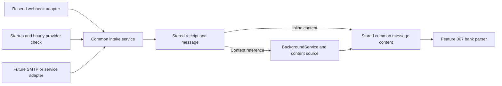

# Feature 006: inbound email reception with replaceable providers

## Goal and scope

Receive an actual email sent to a tenant's bank-notification address, store its source content, and make it available for later bank parsing. Implement a provider-independent intake layer, with Resend as the first live integration and a local stub for development. A future SMTP server or another email service must be able to use the same routing, storage, jobs, and bank parsers.

This feature handles reception and retrieval. [Feature 007](./007-bank-message-parsing.md) interprets bank content and creates transactions. Receiving an email must never directly mark an [expected payment](./005-expected-payments.md) as paid.

The backend remains one ASP.NET Core application with a `BackgroundService`. PostgreSQL runs locally in Docker during development, and the SPA stays local. A real Resend test needs an accessible HTTPS webhook endpoint; Neon and a production frontend are not prerequisites. An SMTP listener, IMAP poller, and a second live service are not implemented in Feature 006.

## 1. Provider-independent intake

### Responsibilities

| Component | Responsibility |
| --- | --- |
| Delivery adapter | Accept and authenticate its own transport, then translate delivery metadata and available content into the common intake contract. Resend-specific webhook types, signatures, and SDK objects stay here. |
| Address provisioner | Support address assignment for its configured domain. Pairrot owns the address reservation and tenant mapping; an adapter handles any provider-specific setup. |
| Content source | Retrieve content when delivery contains only a reference. An adapter that delivers full content does not need to implement remote retrieval. |
| Message discovery source | Optionally list received messages to recover missed deliveries. Resend implements this capability; a future SMTP adapter may instead rely on its durable spool. |
| Intake service | Apply common validation, deduplication, tenant routing, quarantine, and durable storage. Return an outcome that the adapter translates into its transport acknowledgement. |
| Background worker | Retrieve deferred content through the configured content source and manage common retry and lease rules. |
| Bank parser | Read the persisted common message model and trust evidence. It does not know which vendor or transport delivered the email. |

Use small application interfaces, for example `IInboundEmailIntake.AcceptAsync`, `IInboundAddressProvisioner.EnsureAddressAsync`, and `IInboundContentSource.RetrieveAsync`. Names are illustrative; the separation of responsibilities is required. Register adapters by their configured kind and instance. Domain services must not branch on `resend`, reference a provider SDK, or require HTTP headers.

### Common delivery contract

The adapter supplies an internal `InboundDelivery` after checking its transport. It is not a public JSON contract that tenant callers can submit directly.

| Data | Meaning |
| --- | --- |
| `provider_instance_id` | Stable identity of the configured provider account or receiving server, assigned by Pairrot configuration. |
| `source_delivery_id` | Stable transport delivery/event identity for replay detection. |
| `source_message_id` | Stable message identity within that instance; not the sender-controlled RFC Message-ID. |
| `received_at` | Reception time reported by the trusted receiving system. |
| `envelope_recipients` | Actual delivered recipients, with evidence provenance. Unreliable or unavailable envelope information must be explicit. |
| `envelope_sender`, `header_from`, `subject` | Available metadata; the header sender is not automatically authenticated. |
| `delivery_evidence` | How the adapter authenticated the transport and where that evidence came from. |
| `sender_authentication` | Normalized SPF, DKIM, and DMARC results, authenticated identities where available, evidence origin, and preserved raw results. Unavailable or ambiguous results stay `unknown`. |
| `content` or `content_reference` | Either a complete bounded source snapshot or an opaque reference retrievable through this instance's content source. Exactly one delivery mode is selected. |
| `source_kind`, `environment` | `received` or `fixture`, and `live` or `test`, set by trusted adapter configuration. |
| `transport_metadata` | Provider-specific diagnostic data, stored separately from fields consumed by the parser. |

The common source snapshot contains text, HTML, headers, addresses, attachment metadata, and authentication evidence. Adapters retain original values where normalization could lose meaning. A future SMTP adapter may decode MIME into this snapshot before submission; bank parsers still receive the same structure.

An adapter must provide stable transport identities across retries. If the source has no suitable ID, its bridge must durably assign one before its first intake attempt and reuse it. Generating a fresh random ID on every retry or using a content hash as the sole message identity is not acceptable.

### Delivery modes

- **Deferred content:** Resend supplies a notification and message reference. Intake saves it and schedules retrieval through the Resend content source.
- **Inline content:** A future trusted SMTP bridge or service may supply the complete message immediately. Intake saves the content atomically with the receipt, without a redundant fetch job.

Both modes use the same ownership, quarantine, size-limit, deduplication, and source-trust rules. A later provider without sender-authentication evidence must report `unknown`; it cannot invent a passing bank-origin check to satisfy the interface.

Transport acknowledgement follows durable acceptance. For a future SMTP bridge, this means acknowledgement only after Pairrot commits or after the receiving server commits to its own durable spool with a guaranteed handoff retry. HTTP status codes are a Resend adapter concern, not the common intake result type.

### Resend adapter: verified external contract

Resend supports receiving at its managed subdomain or a configured custom receiving domain. A receiving domain accepts addresses under it, so Pairrot can allocate opaque local parts and keep its own routing map; a new provider mailbox is not required for every tenant. [Resend receiving documentation](https://resend.com/docs/dashboard/receiving/introduction).

The `email.received` webhook contains metadata. Body text, HTML, and headers are retrieved separately from the Receiving API. Do not expect the webhook to contain a complete bank email. [Resend email content](https://resend.com/docs/dashboard/receiving/get-email-content).

Verify the original request body with the endpoint's signing secret and the `svix-id`, `svix-timestamp`, and `svix-signature` headers, using a supported verifier and its timestamp checks. Parsing and reserializing JSON before verification can invalidate the signature. [Resend webhook verification](https://resend.com/docs/webhooks/verify-webhooks-requests).

The Receiving API exposes provider-computed authentication results as well as message content. Persist those results separately from sender-supplied headers. A valid webhook establishes delivery by Resend; it does not establish that the email originated at a bank. [Retrieve received email](https://resend.com/docs/api-reference/emails/retrieve-received-email).

The Resend adapter maps these fields and authentication results into the common contract. Its content reference contains the provider email ID; its delivery ID comes from verified signature metadata. The policies, tables, state names, limits, and API paths below are Pairrot design decisions.

## 2. Live addresses and existing stub addresses

Introduce `inbound_addresses` as the durable address-to-bank-connection map. Each record has an immutable address, tenant, bank connection, provider instance, environment (`test` or `live`), lifecycle state (`active` or `retired`), and creation time. Provider kind is a separate configured value: initially `stub` or `resend`, with other registered kinds possible later. Do not encode the vendor name into a fixed domain lifecycle enum.

- Migrate every existing Feature 003 test address into this table without changing its value or owner.
- Keep test addresses marked as stub addresses. A `.test` address never becomes a real receiving address.
- Use one application-configured Resend receiving domain for the initial integration. Domain and provider-account setup are administrative, not tenant-supplied values.
- Reserve the opaque address and owner in Pairrot, then use the selected address provisioner if that provider needs setup. Resend's domain-wide reception requires no per-address mailbox creation. Address assignment must not require all future providers to work the same way.
- In live mode, the existing `POST .../bank-connections/{id}/inbound-address` operation allocates a live address. If that connection already has one, return it unchanged.
- If it has only a stub address, explicitly allocate a new live address, retain and retire the old stub record, and report that a replacement occurred. Configuration changes alone must not rewrite addresses.
- Return the assigned address, mode, and whether it replaced a stub. Require the same active-tenant, active-connection, and direct-child permissions as Feature 003.
- If a later adapter requires remote provisioning, keep a durable reservation and report pending or failed setup until it succeeds. Retry against that same reservation; never report a usable address before setup is complete. Resend and the stub may complete assignment immediately.
- Enforce one active live address per bank connection and globally unique normalized address values. Retired addresses remain reserved forever and retain their ownership mapping.
- Preserve the old bank-connection response fields as a projection of its current address. Store ownership and assignment truth in the address table, not in two independently editable places.

No endpoint lets a user choose a different tenant as the address owner. Arbitrary live-address rotation or provider-account migration is deferred. Changing the default provider affects new assignments only; existing addresses and deferred jobs retain their original provider-instance binding. A provider switch must not reinterpret another instance's message IDs or silently replace an address already configured in a bank.

### What the user sees

For live mode, show the address and generic instructions to add it as the recipient of incoming-payment notifications in internet banking. Bank-specific instructions can follow once verified for the selected bank. The stub warning remains for test addresses.

Show separate facts rather than a single “connected” flag:

- Address assigned, with explicit mode.
- Last provider-reported message time.
- Last successful content retrieval time and last retrieval error, if any.
- Bank source verification and parsed-transaction time, added by Feature 007.

A personal test email can demonstrate delivery but cannot verify bank origin or a received payment.

## 3. End-to-end reception flow

1. The selected adapter receives and authenticates its transport. For Resend this is `POST /v1/webhooks/resend`, with raw-body signature and timestamp verification.
2. It validates its event structure and maps supported delivery into the common contract. Unsupported vendor event types are handled by that adapter.
3. Common intake deduplicates the receipt and finds or creates the message using the instance-scoped source identities.
4. Resolve ownership from trusted delivered-recipient evidence and Pairrot's address map. Do not use email body text, a caller-supplied tenant ID, subject, or an untrusted forwarded header to choose a tenant.
5. Atomically save the receipt, metadata, routing result, and either inline content or a retrieval job for deferred content.
6. Return a common durable-acceptance outcome; the adapter acknowledges its transport. Do not wait for deferred content fetching or bank parsing.
7. If retrieval is needed, the worker selects the original instance's content source, retrieves by its opaque reference, and stores the common snapshot.
8. Mark content available only after it is saved, regardless of delivery mode. Feature 007 picks up eligible messages from this same persisted state.

If PostgreSQL is unavailable, return a retryable error instead of acknowledging work that was not saved.

## 4. Routing and isolation

Match normalized full envelope recipients supplied by the authenticated adapter against the address map and its expected provider-instance binding. A claimed address delivered through the wrong instance is quarantined as a transport mismatch. If authoritative recipient evidence is missing, quarantine rather than guessing. Do not treat the public email `Message-ID`, visible sender, or Resend's `received_for` header-derived hints as ownership proof.

| Recipient result | Action |
| --- | --- |
| Exactly one known live bank connection | Bind the message to that tenant and connection. Multiple aliases for the same connection still yield one owner. |
| No known live recipient | Quarantine as `unknown_recipient`. |
| Recipients map to more than one bank connection | Quarantine as `ambiguous_recipient`; do not fan out copies to different tenants. |
| Known retired address, archived connection, or inactive owner/parent | Bind for history but hold further bank processing with an explicit reason. |

Unrouted and ambiguous messages are visible only through administrative tooling, never through tenant lists. A tenant cannot claim a quarantined message by supplying its ID. Provider metadata is retained for diagnosis; deferred content retrieval can wait until an administrator resolves the route. Inline content, if supplied, is retained within the same quarantine and is not disclosed to any candidate tenant.

For a resolved route, retrieve and retain source content even when processing is held. This preserves late notices and the reason they were not processed. An administrator may retry routing only against the address map; do not provide a “move this email to any tenant” action.

After content becomes available, compare its delivery evidence with the adapter's original routing evidence. Conflicting authoritative evidence places the message on hold; visible To/Cc headers are not a substitute for envelope recipients. Do not silently change the owner or render a cross-tenant message as a child tenant's private content.

Suspended or deleted tenant access follows Features 001–003. Provider receipt itself is independent of customer login, so valid events can be acknowledged and retained while ordinary tenant access is blocked.

## 5. Saved source content

For the Resend implementation, use `GET /emails/receiving/{email_id}` on the bound provider account and translate the response into the common source snapshot. Preserve returned text, HTML, headers, addresses, subject, provider timestamps, provider authentication results, and attachment metadata. [Receiving API](https://resend.com/docs/api-reference/emails/retrieve-received-email). This route and its response DTOs belong only to the Resend adapter.

Do not download attachments, inline images, URLs found in the body, or linked bank statements in this feature. The stored source is the content supplied or retrieved by the adapter, not a reconstructed parser output. A byte-for-byte MIME archive is deferred; parsing in Feature 007 must work from persisted common text, HTML, metadata, and trust evidence without calling a provider or reading vendor-specific JSON.

Set application-level size limits; proposed defaults for the Resend adapter are 1 MiB for webhook bodies and 5 MiB for a retrieved content response. Apply a common 5 MiB content-snapshot limit to both delivery modes. A future adapter must additionally bound its own wire/MIME input before decoding; it does not inherit Resend's metadata-only webhook limit. Stream with limits rather than buffering unbounded input. Oversized content gets a visible error with retained metadata; do not truncate it and present it as complete. These are Pairrot limits, not provider service limits.

Display the source as plain text or escaped HTML source in the local SPA. Do not execute email HTML, load external assets, or expose access tokens, signatures, or provider secrets in API responses or logs. Raw source responses use `Cache-Control: no-store`.

## 6. Reliable background processing

Add a small PostgreSQL-backed job mechanism, shared later with Feature 007. No additional queue service is required.

Jobs contain a type, target ID, generation, state, attempt count, due time, lease owner/token, lease expiry, and last safe error. States are `queued`, `running`, `retry_wait`, `succeeded`, and `failed`.

- Claim work atomically and use an expiring lease so an interrupted job can be resumed.
- Before writing results, verify that the worker still owns its lease. A stale worker must not overwrite a newer completion.
- Prevent multiple active jobs for the same operation and target. Retries use the same operation; explicit reprocessing starts a new generation after the previous one ends.
- Save result changes and job completion together. Recovery after a crash must not create another message or source snapshot.
- Retry timeouts, rate limits, and temporary server failures with bounded delays. Respect provider retry guidance, including `Retry-After` when supplied.
- Proposed defaults: six total attempts, with delays of 1 minute, 5 minutes, 30 minutes, 2 hours, and 6 hours. Make them configurable.
- Persistent authorization errors, exhausted retries, unavailable content, and size-limit failures remain visible and can be retried explicitly after their cause is addressed. A temporarily unavailable new message may be retried before classifying it as permanently unavailable.
- Workers receive normalized content-source outcomes such as temporary failure, rate-limited with retry time, permanently unavailable, or credentials/configuration error. They do not inspect Resend-specific exceptions or HTTP response DTOs. Inline deliveries do not create content-retrieval jobs.

Provider webhook delivery retries and Pairrot retrieval retries are separate. Resend may also replay events, so an acknowledged duplicate must be harmless. [Resend retries and replays](https://resend.com/docs/webhooks/retries-and-replays).

Feature 006 content state is `pending`, `available`, or `failed`. Routing state and any processing hold are separate fields. Do not use “parsed” as a synonym for “downloaded”.

### Startup and hourly recovery check

Keep webhooks as the normal delivery path. In addition, schedule a provider check once when the application starts and then every hour. Run it in the background after the database is ready, without delaying HTTP availability. This check recovers messages whose webhook never reached Pairrot, including after a long outage; resuming existing database jobs alone cannot discover them.

Expose discovery through an optional provider-independent interface such as `IInboundMessageDiscovery`. The Resend adapter uses the paginated `GET /emails/receiving` API and maps results into the common intake contract. Pagination and vendor response types remain inside the adapter. [List received emails](https://resend.com/docs/api-reference/emails/list-received-emails).

- Check each enabled provider instance that supports discovery, including instances still serving existing addresses after the default provider changes. The stub uses local fixtures and never contacts Resend.
- Persist a `sync_from` boundary for each instance, defaulting to its initial activation time. An administrator may set an earlier boundary when importing an existing receiving account. The first check covers messages from that boundary; it must not silently limit recovery to the last hour.
- Later checks cover the last successfully completed scan boundary with a one-hour overlap. After an outage, cover the whole unscanned interval, even if it spans several days. The overlap and hourly interval are configurable, with one hour as the default for both.
- Capture an upper boundary at scan start and process all relevant pages. Only advance the completed boundary to that time after every message in the interval is durably recorded or already present. Do not assume the provider supports date filtering or stable timestamp ordering; the adapter must paginate as needed using its documented API behavior.
- Submit discovered messages through common intake with the original provider message ID. Use a deterministic discovery receipt identity in a separate namespace, such as `discovery:{source_message_id}`; webhook identities use their own namespace. A concurrent or later webhook may add its receipt but must reuse the same message and retrieval job. Already available content is not fetched or parsed again just because it appears in a scan.
- Record authenticated provider-API access as discovery evidence; do not invent a webhook signature. Apply the same recipient-evidence, quarantine, and bank-source checks. If discovery metadata lacks authoritative routing evidence, retain the message in quarantine until sufficient evidence arrives; a later verified webhook may resolve it through the normal routing rules. Discovery alone never establishes bank origin.
- Allow at most one check per provider instance at a time, using a database lease. Startup and scheduled checks must not overlap. If the process stops mid-scan, retry from the last completed boundary; saved messages make repeated pages harmless. Lost leases cannot advance the boundary.
- Retry temporary API failures using the existing job retry rules and respect rate limits. On any incomplete scan, leave the completed boundary unchanged. An exhausted run remains visible; the next hourly check can try the same interval again, without creating overlapping jobs.

Store and expose the last attempt, last successful check, covered-through time, next due time, discovered-message count, and safe error in administrative tooling. The check does not re-enable a webhook disabled by Resend. If provider retention or unavailable history prevents full recovery, report the gap explicitly rather than claiming the interval is complete. Recovery is limited to messages still available from the provider.

## 7. Deduplication and HTTP responses

Use two provider-independent identities:

- Delivery receipt: unique `(provider_instance_id, source_delivery_id)`. For Resend, this is the verified signature-metadata event ID; a future SMTP adapter uses a stable receiving-server/spool delivery ID.
- Email: unique `(provider_instance_id, source_message_id)`. For Resend, this is its email ID. Multiple transport events for one message still share one stored message.

Authenticate the transport before accepting a known identity as a duplicate. A known delivery ID with changed content is a conflict to investigate, not permission to overwrite the original. Never deduplicate distinct provider emails solely by subject, sender, message text, amount, or an RFC `Message-ID` header. Different provider instances may observe the same physical bank notice under different IDs; transport deduplication does not merge them across instances. Feature 007's bank-transaction identity rules handle that evidence.

The Resend webhook uses its provider authentication only, without browser cookies or tenant API keys. It is exempt from browser antiforgery requirements, not from signature verification. Another adapter must define its own trusted handoff; it must not reuse a bank customer's API key as proof of bank-email origin. No public generic endpoint accepts a caller's claim that an email is already trusted.

The following response mapping applies specifically to the Resend HTTP endpoint:

| Response | Use |
| --- | --- |
| `200` | A verified event is durably accepted, already recorded, safely quarantined, or is a supported-to-ignore event type. |
| `400` | Invalid signature/timestamp or malformed required event data. |
| `409` | Same verified event identity with conflicting content. |
| `413` | Webhook body exceeds the configured limit. |
| `503` | Temporary inability to save an otherwise valid event. |

Do not use provider retries to resolve an unknown tenant. Quarantine is a successful, durable intake outcome; diagnose and retry internally.

## 8. API and administrative tools

| Endpoint | Behavior |
| --- | --- |
| `POST /v1/webhooks/resend` | Provider intake as above. |
| `GET /v1/tenant/inbound-messages` | Paginated owned messages, filterable by connection, content state, hold reason, and received time. |
| `GET /v1/tenant/inbound-messages/{id}` | Owned metadata, routing/content states, safe retrieval history, and source availability. |
| `GET /v1/tenant/inbound-messages/{id}/source` | Owned stored source content with the normal scope checks. |
| `POST /v1/tenant/inbound-messages/{id}/retry-fetch` | Queue retrieval after a failed attempt; return `202` and the existing or new job ID. |

Mirror message endpoints under `/v1/subtenants/{subtenantId}` for permitted direct-child management. Current-tenant routes accept tenant keys or administrator sessions. Child routes require the parent's management key or authorized session and `can_create_subtenants = true`.

History remains readable to an authorized parent for an inactive child, but user-triggered retries require an active target and ancestry. Retry of already available content returns `409 content_already_available`; future reparsing must use the saved snapshot instead. A source without deferred retrieval returns `409 content_fetch_not_supported` rather than pretending it can fetch content. Foreign IDs return `404`. Session checks, expected-tenant checks, and antiforgery remain applicable to browser operations.

Provide administrative CLI actions to list quarantined/failed receipts, inspect routing reasons, and queue a routing or retrieval retry after fixing configuration. Do not expose a global inbox to tenant users. Record manual retries and address transitions in audit history.

## 9. Logical schema

| Table | Important data and constraints |
| --- | --- |
| `inbound_addresses` | Tenant/connection ownership, globally unique address, provider instance, test/live environment, assignment/provisioning state, active/retired lifecycle, timestamps. At most one active live address per connection. |
| `inbound_delivery_receipts` | Provider instance and source delivery identity, transport kind, optional raw transport payload, digest, authentication provenance, acceptance time, routing outcome, optional message reference. Unique instance/delivery pair; no mandatory webhook columns. |
| `inbound_messages` | Unique instance/source-message pair, optional resolved tenant/connection/address, common metadata, content mode/reference, content state, hold reason, timestamps, digest, common snapshot, normalized authentication evidence with raw provenance, source kind (`received` or `fixture`), and test/live environment. |
| `background_jobs` | Durable work, retry schedule, lease, generation, safe error, and completion state. |
| `inbound_sync_states` | One row per provider instance: initial `sync_from`, completed scan boundary, last attempt/success, next due time, discovery count, and safe error. Use the job lease to serialize checks and protect boundary updates. |

Provider instances have stable configured identities, adapter kinds, environment, and domain settings. Store references to them on addresses, messages, receipts, and jobs; credentials stay in server configuration. Adding a registered provider kind must not require new columns in the payment, transaction, or parser tables. Disabled instances retain their identity and historical records; never reuse an instance ID for another provider account.

Ownership relationships use matching tenant IDs and bank connection IDs in database constraints. An unresolved message has no tenant ownership and is excluded from every tenant query. Adding a message, its receipt, inline content or initial retrieval job is transactional. Existing bank configurations and stub-address history survive migration. The neutral `inbound_delivery_receipts` replaces the earlier proposed name `inbound_webhook_receipts`; existing receipts, if any, must be preserved when migrating.

Content should not be automatically purged as an incidental part of retry handling. Data retention and eventual erasure need a separate explicit policy; no user-facing message deletion is added here.

## 10. Local testing and completion

Keep `stub` as the default for ordinary local work. Configure a registry of provider instances and select one default for new addresses. Initially implement only the stub and Resend adapters; Resend requires server-side credentials, webhook secret, stable instance identity, and a receiving domain. Test adapters may exercise inline delivery without introducing a production SMTP server. API keys and secrets are never stored in tenant configuration or exposed to the SPA.

Automated tests use signed fixture events and a fake Receiving API response. They must exercise real signature verification, persistence, routing, jobs, retries, and access checks. A fake signed event proves transport handling, not bank authenticity. Do not add a public unsigned “test webhook” shortcut.

Set source kind from the server-configured provider adapter/test harness, never from an incoming request field. Fixture imports are available only in tests or explicit development tooling; they cannot be promoted to live source evidence by a tenant.

Shared contract tests must run common intake once with a fake deferred-content source and once with a fake inline-content source. They exercise the same routing, persistence, source-evidence normalization, deduplication, and isolation behavior without importing any Resend DTOs into the domain layer.

The local SPA adds an inbound-message list, source view, status/error display, and retry-fetch action. Unknown or ambiguous messages remain in operator tooling.

Acceptance requires:

1. Existing stub addresses survive migration; live allocation creates a distinct address once and never makes a stub appear live.
2. Invalid or expired signatures fail; signed events with body tampering fail; valid duplicate and concurrent events create one receipt/message/job as applicable.
3. Different provider events for the same email retrieve one stored message. Database failure returns a retryable response rather than losing the event.
4. Known recipients route correctly; unknown, ambiguous, retired, and inactive-target cases are handled without cross-tenant disclosure.
5. Fetch errors retry and survive restart. Stale leases cannot commit a second result. Terminal failures are visible and manual retry works.
6. Stored source and authentication evidence remain readable after restart without contacting Resend again. Unsafe HTML and oversized content are handled as specified.
7. Tenant and direct-child access are verified, including source views and retry actions. No bank transaction or payment state is created by intake alone.
8. A controlled real email sent to an assigned live address produces a verified webhook and stored source through Resend. Record the result separately from fixture tests. This step does not require sending a bank transfer.
9. Equivalent inline and deferred deliveries produce the same common source fields and parser input. Only deferred delivery creates a retrieval job; missing authentication evidence remains unknown in both modes.
10. Changing the default provider does not change existing addresses or redirect queued fetches. Instance-scoped IDs cannot collide across accounts, and old messages can be parsed without loading their original provider SDK.
11. Shared routing, message storage, job scheduling, and bank parsing contain no Resend-specific DTO, signature, or event-type dependency. The documented contracts can accommodate an SMTP bridge without requiring a second live implementation in this feature.
12. Startup schedules one background discovery check, followed by hourly checks. A missing webhook is recovered through provider listing and the same intake path; concurrent webhook and discovery create one message and at most one active retrieval job.
13. A multi-page scan, a multi-day outage, and a crash or API failure between pages do not skip messages or advance an incomplete boundary. Restart repeats safely, the overlap includes boundary messages, and concurrent workers cannot complete the same scan under stale leases.
14. Discovery preserves tenant isolation and source-trust checks. Missing recipient evidence is quarantined, provider errors and recovery gaps are visible, and providers without discovery support do not trigger unsupported API calls.

Provider credentials and a reachable webhook are required only for the real-provider acceptance check. If unavailable, report that check as pending; do not label fixture-only testing as verified live reception.
