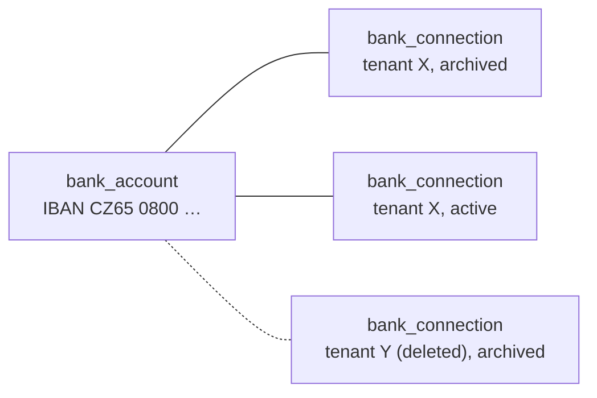

# Feature 013: bank account identity, release, and reuse

Status: implemented (see [Implementation notes](#implementation-notes)). Replaces the "one IBAN, one connection, forever" rule of [Feature 003](./003-bank-configuration-and-inbound-address.md).

## Goal and scope

Feature 003 made the normalized IBAN unique across every bank connection in the system, archived ones included (`bank_connections_iban_unique`), and tenant deletion keeps the deleted tenant's connections. Four ordinary situations therefore end in `409 account_unavailable` with no way out:

1. A tenant archives a connection by mistake, or replaces it and wants the old account back.
2. A deleted tenant is created again (the integrating application erased an instructor's account and the instructor signed up again) and cannot register their own bank account.
3. One person has two tenants under the same parent (two NaLekci profiles, or a studio and its owner) paid to one account.
4. The account changes hands between two tenants of the same parent.

The rule was meant to keep "different recipients do not share one bank account" (MVP specification, section 5). Routing never depended on it: a message belongs to a connection by its inbound address (Feature 006), not by the account printed in it. What the rule actually protects is everything keyed by connection that must be unique per physical account: the variable-symbol namespace (Features 005 and 012) and transaction identity (bank references and lookalike fingerprints, Feature 007). Allowing a second connection for the same account without moving those keys would let one real payment match two requests.

This feature separates the **physical account** from a tenant's **registration** of it:

- Exclusivity applies only among active registrations. Archiving or tenant deletion releases the account.
- Variable symbols, bank references, and lookalike comparison are keyed by the account, not by the registration.
- A tenant's open requests on an earlier registration stay payable by notifications received through its later registration of the same account.

Sharing one account between two active tenants at the same time remains out of scope; section 8 sketches it so this feature does not block it.

## 1. Model

| Record | Meaning |
| --- | --- |
| `bank_accounts` | One row per physical account: `id`, normalized `iban` (unique), `account_number`, `bank_code`, `currency`, `created_at`. Created on first registration, never deleted. This retained account identity is not anonymous; Feature 014 documents the erasure exception and access restrictions. |
| `bank_connections` | A tenant's registration of an account: gains `bank_account_id` and `archived_reason`. The `account_number` and `iban` snapshot columns stay for responses and history. |
| `variable_symbol_allocators` | Keyed by `bank_account_id` instead of `bank_connection_id`. |
| `incoming_transactions` | Gains `bank_account_id`, consistent with its owning connection. Retained transactions themselves hold the unique bank-reference claim and the account-wide comparison fingerprint; there is no separate movement registry. |

Rules:

- At most one **active** connection per account in the whole system: a partial unique index on `(bank_account_id) WHERE status = 'active'` replaces the IBAN index.
- `archived_reason` is `user` (the tenant or parent archived it), `tenant_deleted`, or `operator`. Restore never implicitly archives another registration.
- Deleting a tenant archives its active connections with `tenant_deleted` in the same transaction. The migration does the same for tenants that are already deleted.
- An archived connection keeps its address, messages, requests, transactions, and allocations exactly as today. Feature 006's hold rules for mail arriving at an archived connection are unchanged.

## 2. Registration and restore

| Situation on `POST .../bank-connections` | Result |
| --- | --- |
| The caller's tenant already has an active connection for the account | `409 bank_connection_exists` with `bank_connection_id` of the existing one. Today's generic error gave the caller nothing to repair. |
| Another tenant has an active connection for the account | `409 account_unavailable`, unchanged and still generic: it must not reveal the holder. |
| Only archived connections exist, in any tenant, deleted tenants included | `201`, a new connection on the existing `bank_accounts` row. |
| No connection has ever existed | `201`, a new account row and connection. |

`POST .../bank-connections/{id}/restore` returns an archived connection of an active tenant to `active`:

- Refused with `409 account_unavailable` while another connection for the account is active anywhere, with `409 tenant_not_active` for a suspended or deleted owner, and with `409 bank_connection_erased` after Feature 014.
- A retired address stays retired; the current address is unchanged. Replacing an address does not archive its bank connection.
- Messages held only because the connection was archived (`hold_reason = bank_connection_archived`) are re-evaluated in the same transaction and, when nothing else holds them, queued for parsing. Nothing already parsed is reparsed.
- Repeating a restore is a no-op. Restore is audited as `bank_connection.restored`.

Why any tenant may register a released account: a number proves nothing (Feature 003 says so), and the pipeline is address-based, so a registration receives only what the bank or a forwarder sends to that registration's address. The remaining risk is squatting: an active registration by the wrong tenant blocks the real holder. Within one parent the parent created both and can archive the wrong one; across roots the operator CLI gets a global view (section 5).

## 3. Variable symbols per account

- Uniqueness of `variable_symbol_key` moves from `(bank_connection_id, …)` to `(bank_account_id, …)` over every request of the account, whatever its tenant or connection. The same symbol on another account stays allowed.
- The allocator is one row per account. The cursor carries over from the connection's allocator in the migration (today the two are one-to-one).
- Automatic allocation skips every symbol already saved on the account, including symbols of another tenant's archived registration. Nothing else about Feature 012 changes: no reuse, no reset, no wrap, exhaustion as before.
- A supplied symbol already used on the account by any registration is `409 variable_symbol_conflict`. The message stays as it is and names no owner. A tenant re-registering its own account therefore sees its own old symbols conflict, which is correct: the old QR codes are still out there.
- The fingerprint of a creation and its replay are untouched.

## 4. Transactions and matching per account

- Bank-reference uniqueness on `incoming_transactions` becomes `(bank_account_id, bank_profile, bank_transaction_id) WHERE bank_transaction_id IS NOT NULL`, across all tenants and transaction states. Transactions, references and comparison facts survive tenant erasure (Feature 014), so this index continues to prevent reuse without a separate registry. Ownership is never silently transferred.
- Parsing and review commands that can create/approve a transaction serialize their account-wide duplicate checks under the same account lock. The unique index remains the final safeguard. A concurrent uniqueness conflict must be handled through rollback/retry or a savepoint so that a fresh transaction can record the local conflict review; never attempt to continue writing in an aborted database transaction or leave only a failed parse job.
- For a reference already owned by the **same tenant**, matching critical facts link the new message to the existing transaction, even across connections. Different facts open a dispute under that tenant and do not create a second movement. The original transaction's receiving connection stays unchanged.
- For a reference owned by **another tenant**, no new transaction is created. The new message ends as `review_required` with `account_movement_conflict`, without a transaction link, allocation, or change to the other tenant's records. Its review contains only local evidence and a generic reason; no foreign IDs, amounts, history or source messages are returned. The operator closes a confirmed copy using `reject` with structured reason code `duplicate_of_foreign_movement`. A proven reference conflict cannot be approved as a distinct payment, including by an operator; transferring historical ownership is outside this feature.
- Lookalike comparison (Feature 007, no reference on at least one side) runs over the account. Within one tenant, it opens the usual duplicate review across connections. Across tenants, a new transaction is created as `review_required`, unallocated and blocked by `account_movement_conflict`; the old transaction is unchanged and foreign candidates are not exposed or added as review members. The operator resolves the local observation using `reject` with `duplicate_of_foreign_movement`, or `confirm_distinct` after establishing it is a separate payment. Approval makes only that local transaction eligible for manual allocation, subject to all other review blocks. No foreign canonical pointer or alias is saved, and `mark_duplicate` is not offered for a cross-tenant conflict.
- Automatic matching (Feature 009) selects candidates by **same tenant and same account**, any connection and any connection status. The transaction's own connection is active by construction, because only active connections parse. The exactly-one rule, the full-amount rule, and every explanation code stay as they are.
- A request on an archived connection is therefore paid when its payer uses the instructions issued earlier, and the `payment_request.updated` event carries the old request ID and `external_id`. Fresh instructions for that request remain refused (`409 bank_connection_archived`): new codes belong on the current registration.
- Allocations keep both connection IDs. The Feature 009 invariant "both sides belong to the same tenant and bank connection" becomes "the same tenant and the same account", enforced in PostgreSQL by a trigger that compares `bank_account_id` of the two connections, in addition to the composite owner references. Candidate search and manual allocation use the same scope.
- Requests and transactions of another tenant's registration are never visible or matchable. A new movement that passes duplicate checks but carries a symbol from the previous holder's request is `request_not_found` for the new holder; movement conflicts take precedence over matching.
- Review cases keep a receiving connection, but their same-tenant members may originate from other connections of the same account. Composite owner references and database account-consistency checks apply to parse-run transaction links, transaction sources, duplicate pointers, review members, and allocations. A transaction source carries its receiving connection separately from the transaction's original connection. Cross-tenant cases contain only local evidence, never foreign transaction members or pointers. The migration must update all these constraints, not only allocation constraints.

The existing database check for `handling = duplicate` still requires a canonical transaction of the same tenant; its relationship is widened only to allow another connection of the same account. Cross-tenant copies use `rejected`, so no alternate duplicate representation or movement aliases are needed. The review decision records the operator, structured reason code, local case/transaction IDs, versions and timestamp, without a foreign identifier. This iteration deliberately omits a persistent link identifying which foreign transaction was the original.

The review service needs an explicit operator-only branch for `account_movement_conflict`: today's `confirm_distinct` requires at least two local transactions, while this branch accepts exactly one local lookalike. Tenant and parent callers cannot use it. `confirm_payment`, `keep_existing`, reopening, reprocessing or enabling automatic matching must not bypass the restriction or a proven bank-reference conflict. Reopening preserves the conflict classification and restores the allocation block; it does not grant approval. Operator decisions recheck current account-wide evidence under the account lock and use existing version/idempotency/audit rules. The general review CLI invokes this service; no separate account-movement command is introduced.

Comparison fingerprints use version `v2`: SHA-256 of the existing canonical tuple with `bank_account_id` replacing `bank_connection_id` and the version marker changed to `v2`. Migration recomputes every stored comparison fingerprint from persisted critical facts, including archived and deleted-tenant transactions. Changing an index alone is insufficient. Creation/idempotency fingerprints are unrelated and remain unchanged.

## 5. API and CLI

- Bank connection responses gain `bank_account_id`, `archived_reason`, and keep `archived_at`. Payment request, transaction, allocation, and candidate responses gain `bank_account_id`.
- `POST .../bank-connections/{id}/restore` under `/v1/tenant` and `/v1/subtenants/{subtenantId}`, with the existing permissions and the browser checks.
- `GET .../bank-connections?include_archived=true` already exists and now also shows `archived_reason`.
- The `payment_request.updated` event adds `data.bank_account_id`. Adding a field keeps `schema_version` 1.
- Operator CLI, never over HTTP: `accounts show <iban|account-number>` lists every registration of an account across tenants with status and dates; `accounts release <connection-id> --reason <text>` archives a registration with `archived_reason = operator`, audited on the owner.
- Provide an operator CLI entry `reviews resolve <case-id>` to the existing review decision service, with `--decision`, `--reason-code`, `--reason`, expected versions and an idempotency key. The cross-tenant branch permits `reject` or, for a lookalike without a conflicting proven bank reference, `confirm_distinct`; it cannot be invoked with tenant/management HTTP authority.

## 6. Migration

One migration, deployed together with the application without older instances still writing (the allocator key changes, as in Feature 012):

1. Create `bank_accounts` from the distinct normalized IBANs of `bank_connections`; set `bank_account_id` on every connection; both `NOT NULL` afterwards.
2. Move `variable_symbol_allocators` to `bank_account_id`, carrying each cursor over.
3. Replace `payment_requests_variable_symbol_unique` and the allocator's gap index with their `bank_account_id` versions. Backfill `incoming_transactions.bank_account_id` from its connection and enforce consistency; move its unique reference index to account/profile/reference, recompute every comparison fingerprint as `v2`, and create the account/fingerprint index. Preserve original transaction IDs and financial facts.
4. Add `archived_reason`; backfill `user` for archived rows; archive the active connections of deleted tenants with `tenant_deleted`.
5. Drop `bank_connections_iban_unique`; add the partial unique index on active registrations.
6. Migrate source-link, parse-run, duplicate-pointer, review-member, and allocation references to retain tenant isolation while allowing same-account connections; install and validate their account-consistency checks.
7. Self-check: every connection has an account, the number of accounts equals the number of distinct IBANs, every allocator has exactly one account, no account has two active connections, all transaction account IDs agree with their connections, bank references are unique per account/profile, every fingerprint recomputes identically as `v2`, all owner/account constraints hold, and `payments check` passes.

The migration is idempotent and runs inside a transaction; a failed self-check rolls everything back.

## 7. Acceptance criteria

1. A tenant archives a connection and registers the same account again: `201`, a new connection on the same account. A notification arriving at the new address for an open request of the old connection allocates it, and the event carries the old request ID and `external_id`.
2. A deleted tenant's account is registered by a new tenant: `201`. The new tenant sees none of the old tenant's requests or transactions; automatic symbols skip the old ones. A new, non-conflicting movement carrying an old symbol is `request_not_found`; a duplicate reference or lookalike follows the conflict rules instead.
3. Two active registrations of one account cannot exist, also under concurrent creation, restore, and creation racing restore. The cross-tenant error stays generic; the same-tenant error names the existing connection.
4. Restore works for the owner and the parent, is refused while another registration is active, re-evaluates held messages, and is a no-op when repeated.
5. A supplied symbol used by an archived registration of another tenant conflicts; automatic generation never produces a symbol used anywhere on the account.
6. A referenced movement notified through two registrations of the same tenant stays one transaction and retains both source messages. Across tenants the new message opens a local-only conflict case, no second transaction is created, and no foreign data is readable. Conflicting facts cannot mutate the old tenant's transaction. Without a reference, same-tenant lookalikes enter normal review and cross-tenant lookalikes require the restricted operator decision before allocation.
7. An allocation across two connections of the same tenant and account is accepted; across accounts or tenants it is rejected by the database as well as by the service.
8. The migration converts a database with archived, deleted-tenant, supplied-symbol, and automatic-symbol data without changing record IDs, financial facts, symbols, or allocations; derived comparison fingerprints change to `v2`. Re-delivering a pre-migration reference-free movement through a new connection finds the old lookalike. A failed self-check rolls back the migration.
9. Existing responses are unchanged apart from the added fields; the SPA shows the account and the archived reason and offers restore.
10. Concurrent parsers claiming one account/reference leave one transaction and either a same-tenant source link or a durable local-only cross-tenant review, never a lost review after a uniqueness exception. A rejected foreign lookalike has no canonical pointer; operator `confirm_distinct` accepts one local lookalike, but not a proven reference conflict. Tenant/parent approval and reopen/reprocess attempts cannot bypass the operator restriction, including after erasure of the original tenant.

## 8. Not included: shared accounts

Two active tenants on one account need **account grants**: the account has one receiving registration (the one with the address), and the parent grants other tenants in the same root tree the right to create requests against it. Matching scope becomes the tree, the grantees see the account's transactions, and cross-tenant allocation is the parent's decision only. That is a later feature; this one makes it possible by giving the account an identity.

Until then the integrating application can create both profiles' requests on the tenant that holds the registration: its mapping from a booking to a profile is its own, and the event identifies the request by `payment_request_id` and `external_id`, not by the tenant alone.

## Implementation notes

- **Account consistency is declarative.** Instead of triggers, `bank_connections` has the unique key `(tenant_id, id, bank_account_id)`, and every record that names a connection references it with all three columns. References between records use `(id, tenant_id, bank_account_id)`: parse-run and source links to their transaction, duplicate pointers, review members (transaction and run), and allocations. An allocation references both its connections with the one `bank_account_id`, so the database rejects an allocation across accounts or tenants exactly like the trigger would, and it cannot be bypassed.
- **Review cases** belong to the connection that received the deciding message: a dispute raised through a new registration is a case of that registration. An `account_movement_conflict` case has `reason_code` `bank_reference_conflict` (proven; only `reject` applies) or `possible_duplicate` (lookalike; `reject` or `confirm_distinct`). It has no `inbound_message_id`; it is found by its parse runs, one case per message.
- **The cross-tenant block** is `incoming_transactions.movement_conflict`. It is set with the lookalike transaction, makes `account_movement_conflict` the manual and automatic block, is cleared only by the operator's `confirm_distinct`, and is set again when the case is reopened. Tenant decisions that would approve such a transaction are refused with `409 account_movement_conflict`; resolving the case itself is refused with `409 operator_decision_required`.
- **Operator decisions** require `--reason-code duplicate_of_foreign_movement` for `reject`; `confirm_distinct` accepts an optional reason code. Decisions store `reason_code` next to the reason; no foreign identifier is stored.
- **Confirming an unverified candidate** checks the bank reference and lookalikes over the whole account: the tenant's own records are `409 similar_transaction_exists`, another tenant's `409 account_movement_conflict`.
- **The migration** creates accounts with random UUIDs, moves allocators one to one (IBANs were unique per connection), copies the connection ID to `payment_request_bank_connection_id` of existing allocations, and recomputes fingerprints in SQL with the same canonical JSON as `BankMessageEvaluator.ComparisonFingerprint`. Its self-check runs the `payments check` rules in SQL. The generated `Down` restores the schema only; it does not merge reused accounts back.
- **The SPA** shows the account ID and the archived reason on each bank connection, offers Restore on archived ones, and explains `account_movement_conflict` cases without offering a decision.
